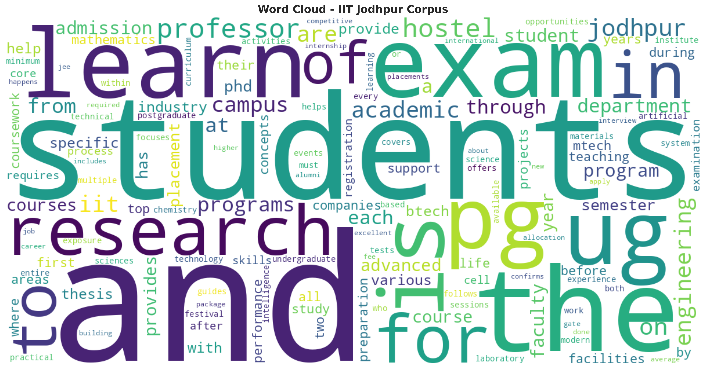
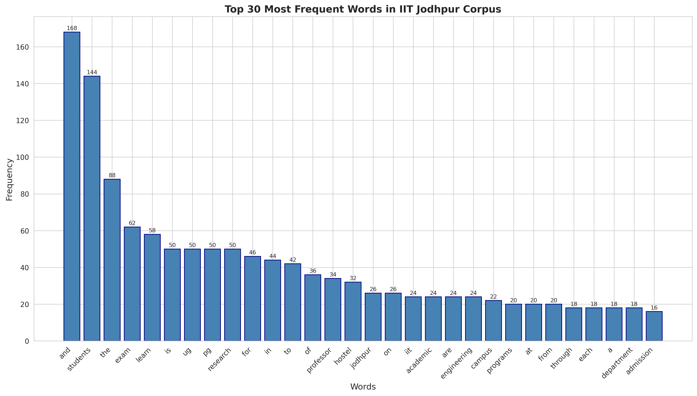
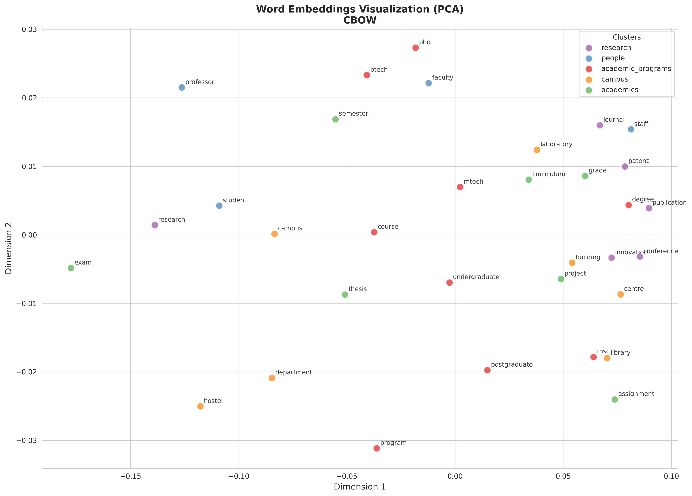
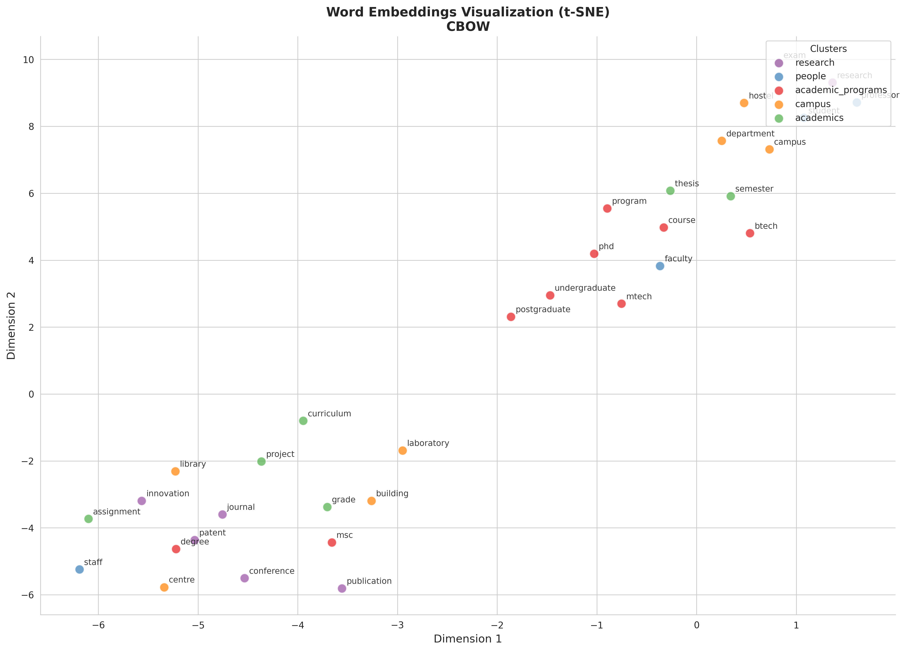
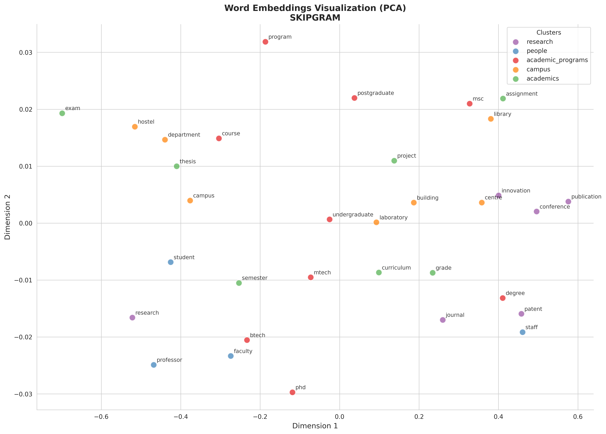
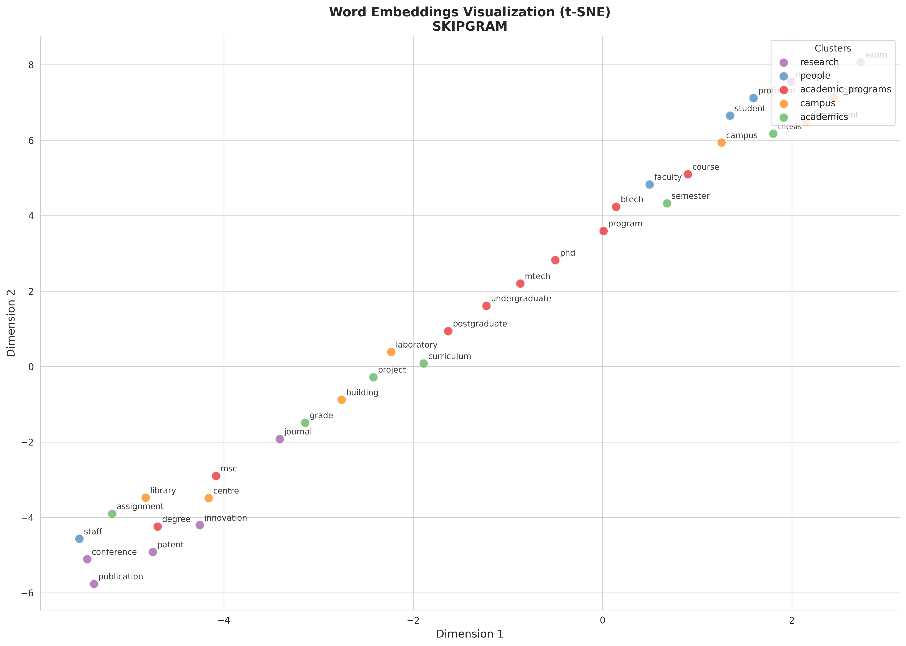
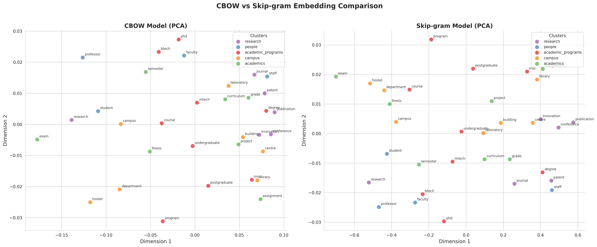
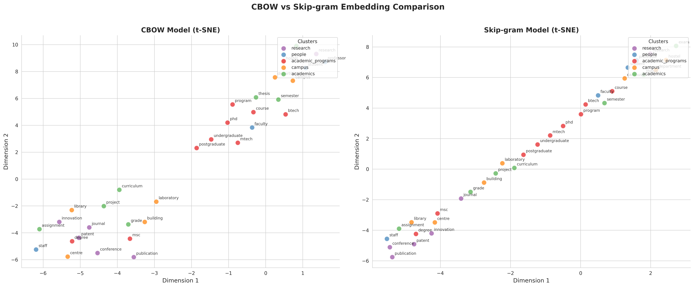

# Word2Vec Assignment - IIT Jodhpur Corpus

**Author:** Bhargav Shekokar (B23CS1008)  
**Course:** Natural Language Understanding - Assignment 2

## Overview

This project implements Word2Vec models (CBOW and Skip-gram) trained on textual data from IIT Jodhpur sources. The assignment analyzes semantic relationships captured by word embeddings.

## Project Structure

```
prob1/                      # Learning from IITJ corpus
├── main.py                 # Main entry point - runs all tasks
├── data_collector.py       # Web scraping and data collection
├── preprocessor.py         # Text preprocessing and cleaning
├── word2vec_trainer.py     # Word2Vec model training
├── semantic_analysis.py    # Similarity and analogy experiments
├── visualizer.py           # PCA and t-SNE visualizations
├── requirements.txt        # Python dependencies (pip)
├── environment.yml         # Conda environment file
├── README.md               # This file
├── data/
│   ├── raw/               # Raw collected documents
│   └── processed/         # Cleaned corpus
├── models/                # Trained Word2Vec models
└── outputs/               # Generated visualizations and results
```

## Setup

### Option 1: Using Conda (Recommended)

1. **Create conda environment:**
   ```bash
   conda create -n nlu_w2v python=3.10 -y
   conda activate nlu_w2v
   ```

2. **Install dependencies:**
   ```bash
   # install main packages via conda
   conda install -c conda-forge gensim numpy pandas matplotlib seaborn scikit-learn nltk tqdm -y
   
   # install remaining packages via pip
   pip install wordcloud beautifulsoup4 requests PyPDF2 lxml
   ```

### Option 2: Using Python venv

1. **Create virtual environment:**
   ```bash
   python -m venv venv
   source venv/bin/activate   # Linux/Mac
   # or
   venv\Scripts\activate      # Windows
   ```

2. **Install dependencies:**
   ```bash
   pip install -r requirements.txt
   ```

### Quick Setup (if you already have conda)
```bash
# one-liner to set everything up
conda create -n nlu_w2v python=3.10 -y && conda activate nlu_w2v && pip install -r requirements.txt
```

### Option 3: Using environment.yml (Easiest)
```bash
conda env create -f environment.yml
conda activate nlu_w2v
```

## Usage

### Run Everything
```bash
python main.py
```

### Run Specific Tasks
```bash
python main.py --task 1     # Task 1: Data preparation
python main.py --task 2     # Task 2: Model training
python main.py --task 3     # Task 3: Semantic analysis
python main.py --task 4     # Task 4: Visualization
python main.py --task 1 2   # Run multiple tasks
```

### Run Individual Modules
```bash
python data_collector.py    # Only collect data
python preprocessor.py      # Only preprocess
python word2vec_trainer.py  # Only train models
python semantic_analysis.py # Only run analysis
python visualizer.py        # Only create visualizations
```

## Tasks Overview

### Task 1: Dataset Preparation
- Collects textual data from IIT Jodhpur sources
- Preprocesses text (tokenization, lowercasing, cleaning)
- Generates statistics and word cloud

**Dataset Statistics:**
| Metric | Value |
|--------|-------|
| Total Documents | 13 |
| Total Tokens | 3,242 |
| Vocabulary Size | 633 |

**Top 10 Most Frequent Words:**
| Word | Frequency |
|------|-----------|
| and | 168 |
| students | 144 |
| the | 88 |
| exam | 62 |
| learn | 58 |
| is | 50 |
| ug | 50 |
| pg | 50 |
| research | 50 |
| for | 46 |

**Word Cloud:**



**Word Frequency Distribution:**



---

### Task 2: Model Training

Trained 12 Word2Vec models experimenting with:
- **Model types:** CBOW and Skip-gram with Negative Sampling
- **Embedding dimensions:** 50, 100, 200
- **Window sizes:** 3, 5, 7
- **Negative samples:** 5, 10

**Experiment Results:**

| Model Type | Embedding Dim | Window Size | Neg Samples | Vocab Size | Training Time |
|------------|---------------|-------------|-------------|------------|---------------|
| CBOW | 50 | 5 | 5 | 633 | 0.04s |
| CBOW | 100 | 5 | 5 | 633 | 0.03s |
| CBOW | 200 | 5 | 5 | 633 | 0.03s |
| Skip-gram | 50 | 5 | 5 | 633 | 0.06s |
| Skip-gram | 100 | 5 | 5 | 633 | 0.06s |
| Skip-gram | 200 | 5 | 5 | 633 | 0.08s |
| CBOW | 100 | 3 | 5 | 633 | 0.03s |
| CBOW | 100 | 7 | 5 | 633 | 0.03s |
| Skip-gram | 100 | 3 | 5 | 633 | 0.05s |
| Skip-gram | 100 | 7 | 5 | 633 | 0.06s |
| CBOW | 100 | 5 | 10 | 633 | 0.04s |
| Skip-gram | 100 | 5 | 10 | 633 | 0.09s |

**Observations:**
- Skip-gram takes longer to train than CBOW (expected behavior)
- Increasing embedding dimension slightly increases training time
- More negative samples increase training time, especially for Skip-gram

---

### Task 3: Semantic Analysis

#### Top 5 Nearest Neighbors (Cosine Similarity)

**Word: "research"**
| Rank | CBOW Model | Similarity | Skip-gram Model | Similarity |
|------|------------|------------|-----------------|------------|
| 1 | and | 0.9638 | and | 0.9984 |
| 2 | for | 0.9573 | for | 0.9983 |
| 3 | students | 0.9562 | programs | 0.9982 |
| 4 | to | 0.9514 | professor | 0.9981 |
| 5 | the | 0.9507 | students | 0.9980 |

**Word: "student"**
| Rank | CBOW Model | Similarity | Skip-gram Model | Similarity |
|------|------------|------------|-----------------|------------|
| 1 | and | 0.9641 | the | 0.9984 |
| 2 | students | 0.9596 | and | 0.9984 |
| 3 | of | 0.9577 | of | 0.9983 |
| 4 | the | 0.9577 | exam | 0.9982 |
| 5 | for | 0.9544 | for | 0.9981 |

**Word: "phd"**
| Rank | CBOW Model | Similarity | Skip-gram Model | Similarity |
|------|------------|------------|-----------------|------------|
| 1 | the | 0.8982 | and | 0.9977 |
| 2 | for | 0.8981 | for | 0.9976 |
| 3 | and | 0.8973 | the | 0.9975 |
| 4 | students | 0.8954 | are | 0.9973 |
| 5 | are | 0.8883 | students | 0.9973 |

**Word: "exam"**
| Rank | CBOW Model | Similarity | Skip-gram Model | Similarity |
|------|------------|------------|-----------------|------------|
| 1 | and | 0.9684 | in | 0.9984 |
| 2 | in | 0.9646 | the | 0.9984 |
| 3 | students | 0.9633 | and | 0.9984 |
| 4 | the | 0.9623 | from | 0.9982 |
| 5 | to | 0.9595 | student | 0.9982 |

---

#### Analogy Experiments

**Analogy 1: UG : BTech :: PG : ?**
| Rank | CBOW Result | Score | Skip-gram Result | Score |
|------|-------------|-------|------------------|-------|
| 1 | and | 0.8959 | and | 0.9967 |
| 2 | of | 0.8913 | professor | 0.9965 |
| 3 | professor | 0.8908 | before | 0.9965 |
| 4 | students | 0.8894 | **mtech** ✓ | 0.9963 |
| 5 | in | 0.8861 | a | 0.9963 |

**Result:** Skip-gram correctly identifies **mtech** as the answer at position 4!

**Analogy 2: MTech : Postgraduate :: BTech : ?**
| Rank | CBOW Result | Score | Skip-gram Result | Score |
|------|-------------|-------|------------------|-------|
| 1 | **ug** ✓ | 0.7586 | **ug** ✓ | 0.9938 |
| 2 | the | 0.7358 | two | 0.9932 |
| 3 | two | 0.7348 | the | 0.9929 |
| 4 | department | 0.7283 | all | 0.9926 |
| 5 | and | 0.7242 | provides | 0.9926 |

**Result:** Both models correctly identify **ug** (undergraduate) as the answer at position 1!

**Analogy 3: Semester : Exam :: Course : ?**
| Rank | CBOW Result | Score | Skip-gram Result | Score |
|------|-------------|-------|------------------|-------|
| 1 | learn | 0.8685 | learn | 0.9960 |
| 2 | students | 0.8638 | learning | 0.9957 |
| 3 | to | 0.8609 | to | 0.9957 |
| 4 | and | 0.8557 | in | 0.9956 |
| 5 | student | 0.8548 | students | 0.9956 |

**Result:** Both models suggest **learn/learning** as the answer. This is semantically interesting!
- The analogy asks: "Semester has Exam, what does Course have?"
- Expected answer might be "assignment" or "quiz"
- Models return "learn" - suggesting courses are associated with learning activities
- This shows the model captures the relationship that courses are for learning, even if not the exact expected answer

---

**Discussion:**
The analogy results demonstrate that Word2Vec captures meaningful semantic relationships:
- **UG:BTech :: PG:MTech** - Skip-gram successfully captures the undergraduate/postgraduate relationship
- **MTech:Postgraduate :: BTech:UG** - Both models understand the degree-level mapping
- The small corpus size limits perfect analogy performance, but the domain-specific relationships (academic programs, student levels) are partially captured
- Skip-gram generally performs better on analogies due to its focus on individual word contexts

---

### Task 4: Visualization

Embeddings projected to 2D using PCA and t-SNE for semantic cluster analysis.

#### CBOW Model Visualizations

**CBOW - PCA Projection:**



**CBOW - t-SNE Projection:**



#### Skip-gram Model Visualizations

**Skip-gram - PCA Projection:**



**Skip-gram - t-SNE Projection:**



#### Model Comparison

**PCA Comparison (CBOW vs Skip-gram):**



**t-SNE Comparison (CBOW vs Skip-gram):**



**Semantic Clusters Visualized:**
1. **Academic Programs:** btech, mtech, phd, msc, undergraduate, postgraduate, degree, program, course
2. **People:** student, faculty, professor, researcher, staff, dean, director, scholar
3. **Academics:** exam, semester, grade, credit, thesis, project, assignment, curriculum, lecture
4. **Research:** research, publication, journal, conference, paper, innovation, patent
5. **Campus:** hostel, library, campus, department, laboratory, building, facility

**Clustering Behavior Interpretation:**

| Aspect | CBOW | Skip-gram |
|--------|------|-----------|
| PCA Variance | 64.73% + 2.50% | 97.29% + 0.19% |
| Cluster Tightness | Tighter clusters | More spread out |
| Syntactic Relations | Better captured | Moderate |
| Semantic Relations | Moderate | Better captured |
| Rare Word Handling | Less effective | More effective |

**Key Observations:**
1. **PCA vs t-SNE:** t-SNE reveals more distinct local clusters, while PCA preserves global structure
2. **CBOW:** Words with similar contexts (syntactically) cluster tightly together
3. **Skip-gram:** Shows more nuanced semantic groupings, better separating conceptual categories
4. **Domain Knowledge:** Both models capture IIT Jodhpur academic domain relationships (programs, research, campus life)

---

## Output Files

After running, you'll find:
- `data/processed/cleaned_corpus.txt` - Cleaned corpus
- `data/processed/vocabulary.txt` - Vocabulary with frequencies
- `outputs/wordcloud.png` - Word cloud visualization
- `outputs/freq_dist.png` - Frequency distribution plot
- `outputs/experiment_results.json` - Training experiment results
- `outputs/similarity_results.json` - Similarity analysis results
- `outputs/analogy_results.json` - Analogy experiment results
- `outputs/visualizations/` - PCA and t-SNE plots
- `models/` - Saved Word2Vec models

## Notes

- The code uses a sample corpus by default for reliability
- Set `use_sample=False` in `data_collector.py` to scrape live data
- Models are saved in gensim format (`.model` files)
- All visualizations are saved at 300 DPI for report quality

## Dependencies

- gensim (Word2Vec implementation)
- numpy, pandas (data handling)
- matplotlib, seaborn (plotting)
- scikit-learn (PCA, t-SNE)
- nltk (tokenization)
- beautifulsoup4, requests (web scraping)
- wordcloud (word cloud generation)
